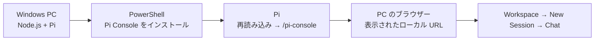
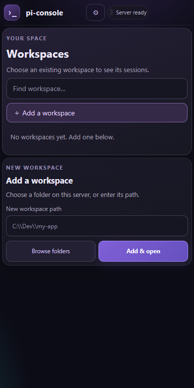
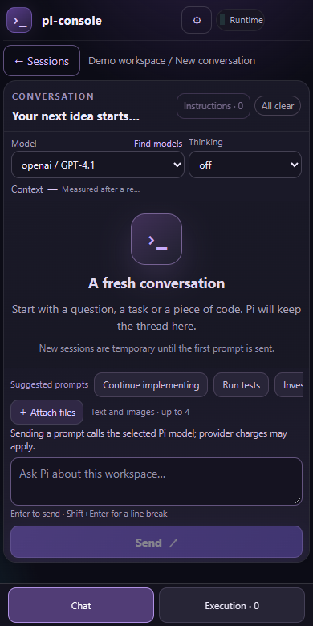

# Pi Console

[English](README.en.md)

Pi の会話と実行状況を、Windows の PC やスマートフォンのブラウザーで確認・操作するためのローカル優先の Web コンソールです。Node.js 24 以降、互換性のある Pi（安定版 0.99.2〜1.4.0）が必要です。Pi の TUI と**同じ会話画面ではなく**、Console が専用の SDK ワーカーで別の Pi セッションを管理します。互換性は最新版 1.4.0 で検証済みです。範囲内の中間バージョンは semver の安定版として許可していますが、すべてのバージョンを個別に実行確認したわけではありません。

> **安全上の注意**：標準モードは認証なしで `127.0.0.1` にだけ接続します。LAN やインターネットへ直接公開しないでください。遠隔利用には [Cloudflare Tunnel + Access の設定](docs/cloudflare-access.md)が必要です。
>
> **旧版から更新する場合**：以前の Windows スタートアップ版は、npm の更新時に消える場所へワークスペース登録を保存していました。**更新する前に**[バックアップと移行手順](docs/upgrade-storage.ja.md)を実行してください。更新後には旧データを回収できない場合があります。

## Dots向け結果read（開発中・既定OFF）

対象runの履歴差分、親/子/queue等のaggregate状態、明示成果物の一覧/内容、対象metadataの共通read coreを追加しました。[ツール契約と制約](docs/dots-results-read-contract.ja.md)を参照してください。

これは既存status-only scopeへの追加公開ではありません。両MCP endpointと稼働接続には未登録で、本文/path/artifact用の明示feature grant、認証済みadapter、実client転送検証が別途必要です。読み取りはworkerを起動せず、承認に回答せず、`controlIsolationVerified()`や更新拒否も変更しません。現runtimeは完全な子作業censusを持たないため全体完了はincomplete、観測のないmodelはunknownです。本番反映・実Dots合格ではありません。

最終回答text 1件に限り、SDK 1.0.2の保存API→runtimeの専用journal→共通read core→認証済み `/mcp/dots` adapter→pin実binaryの隔離縦断を追加しました。`final_answer` のexact-run＋期限付き明示grantが必要です。[契約](docs/dots-final-answer-contract.ja.md) / [実装・検証と未確認範囲](docs/dots-final-answer-result.ja.md)。既定OFF・通常server未登録・実Dots未接続・本番未適用です。

keyholders契約による独立final-onlyレビュー/許可/解除UIと、通常serverの共通compositionをソースへ結線しました。bootstrapは明示 `enabled:false`、専用credentialも未設定です。[今回の隔離UI→実binary→解除検証と操作手順](docs/dots-final-owner-implementation-result.ja.md)。実Dots・本番は未接続/未適用、Access経由owner管理と同一SIDリスクは未解消です。

## すぐに使う

Windows PC に [Node.js 24 以降](https://nodejs.org/en/download) と [互換性のある Pi（安定版 0.99.2〜1.4.0）](https://github.com/earendil-works/pi) を用意します。Pi でモデルを利用するための設定も必要です。



### 1. 公開版をインストールする

**PowerShell** で実行します。`@latest` は npm で公開済みの版を指します。公開版の番号を確認してからインストールできます。

```powershell
node --version
pi --version
npm view @ludi-uni/pi-console version
pi install npm:@ludi-uni/pi-console@latest
pi list
```

npm の公開版より新しいこのリポジトリのソースを使う場合は [ローカル導入](docs/operations.ja.md#導入方法)をご覧ください。**インストールしただけでは Web サーバーは起動しません。**

### 2. Pi から起動する

Pi を再起動するか、**Pi の入力欄**で以下を順に実行します（PowerShell のコマンドではありません）。

```text
/reload
/pi-console
```

Pi が表示した URL（例：`http://127.0.0.1:31717`）を**同じ PC のブラウザー**で開きます。ポートが異なる場合は Pi の表示を優先してください。`127.0.0.1` は接続した端末自身を指すため、その URL をスマートフォンに入力しても PC には接続できません。スマートフォンなどからの遠隔利用は [Cloudflare Tunnel + Access](docs/cloudflare-access.md)を設定してください。

Pi からの起動と Windows スタートアップは、通常 `~/.pi/agent/pi-console/.env` を明示的に読み込みます。Cloudflare 用の設定を npm パッケージの外に保持できます。配置・優先順位・再起動方法は [起動時の `.env` 設定](docs/operations.ja.md#pi-からの起動と-windows-スタートアップの-env)をご覧ください。

サーバーは独立したバックグラウンドプロセスです。Pi を終了・`/reload` しても動き続け、`/pi-console status|stop|restart`（または任意のディレクトリーから `scripts\pi-console.ps1 <コマンド>`／`node package/pi-console.mjs <コマンド>`）で同じサーバーを管理します。`restart` は進行中の Web セッションを中断します。旧版で起動されたサーバーは報告のみで、自動的には停止しません。

### 3. 最初のセッションを作る

1. **Workspaces** で PC 上の作業フォルダーを選ぶか、**Add a workspace** から登録します。
2. **New Session** を押します。初回は Pi の拡張機能の読み込みに最大約1分かかる場合があります。
3. **Chat** でモデルを確認し、指示を送ります。送信すると選択したモデルのプロバイダー料金が発生する場合があります。

画面例（モバイル幅・デモ用ワークスペースとモデル。表示は設定により異なります）：

| ワークスペースを登録 | 新しいセッションの Chat |
| --- | --- |
|  |  |

最初に `Server ready · no Pi session` と表示されるのは、セッションを選ぶ前の正常な状態です。画面の使い方は [使い方ガイド](docs/usage.ja.md)をご覧ください。

### うまく起動しないとき

| 状況 | 確認すること |
| --- | --- |
| `pi` コマンドが見つからない | Pi のインストールと PowerShell の再起動を確認します。 |
| `/pi-console` が使えない | Pi で `/reload` を実行するか Pi を再起動し、`pi list` で登録を確認します。 |
| ブラウザーから接続できない | `/pi-console status` でサーバーの状態とポートを確認し、表示された URL を同じ PC で開きます。 |
| セッションの起動が失敗する | 画面のエラーを確認し、**New Session** を再試行します。繰り返す場合は [運用・開発ガイド](docs/operations.ja.md)を参照してください。 |

ソースからの導入、単独の `npm start`、保存先や起動設定は [運用・開発ガイド](docs/operations.ja.md)にまとめています。

## 目的別ガイド

| やりたいこと | 説明 |
| --- | --- |
| 会話、ファイルのプレビュー、実行状況を使う | [使い方](docs/usage.ja.md) |
| データの保存先、起動設定、テストを確認する | [運用・開発ガイド](docs/operations.ja.md) |
| 旧版から安全に更新する | [更新前のバックアップと移行](docs/upgrade-storage.ja.md) |
| 保護された遠隔アクセスを設定する | [Cloudflare Tunnel + Access（英語）](docs/cloudflare-access.md) |
| 内部設計を調べる | [設計資料への案内](docs/operations.ja.md#設計資料) |

## 今回のソース追加（未公開・本番未適用）

- **停止中更新**：`node .\scripts\stopped-update.mjs --check` の1操作で、既存起動元・観測不足・本人の残る操作を診断します。通常終了後の排他、対象 identity、ソフトウェア専用バックアップ／復元コアを追加しましたが、管理外の直接起動を排他できないため **本番 `--apply` は拒否を維持**します。診断を「停止保証」「更新完了」と扱わないでください。[停止中更新の手順と限界](docs/stopped-update-operations.ja.md)
- **Dots の対象別権限**：別途承認された適用後、本人ローカル GUI の「設定 → Dots ワークスペース権限」で登録 ID/path と観測済み session を個別選択し、read/control の確認・保存・解除を行えます。初期値は none。control は専用認証とワーカー隔離の証明が必須で、**現行の本番ワーカーは隔離未証明のため操作を拒否**します（scopeやキー設定だけでは解除不可）。全体許可・接続変更・キー入力・Events 操作は提供しません。[本人の設定手順と認証・解除の境界](docs/dots-workspace-permissions.ja.md)

新しい権限は `/mcp/dots` 用です。**既存 `/mcp/readonly` の固定 scope は移行・拡張・解除されません**。実 Dots 接続の互換性・本番動作は未検証で、適用・操作用認証設定・接続変更・実際の許可保存は別途本人確認が必要です。準備済み139ファイルの Events tgz は今回の新ソースの配布物ではありません。

検証結果・保全記録・残る阻害要因は [今回の成果物レポート](docs/workspace-permissions-update-result.ja.md) にまとめています。`npm test` には更新／権限のコア回帰を追加しました。SDK 実コード契約とブラウザーの隔離検証はレポート記載の専用コマンドで行い、本番接続を伴う `test:real` は今回実行しません。

## 任意のペット素材

フィオ（素材の権利表示：DOLL Project / Ludi）は `package/pets/fio/` に画像と設定を同梱しています。画像にはソフトウェアの MIT License ではなく別途 [Fio Character Asset License](package/pets/fio/FIO_ASSET_LICENSE.md) が適用されます。Codex やユーザー領域のパッケージなしで利用できます（8 列 × 11 行、バージョン 2）。Codex 公式の組み込みペット画像は配布していません。Pi Console は OpenAI と無関係の独立したプロジェクトであり、OpenAI の承認を受けていません。サーバーの `~/.pi-console/pets`、`~/.codex/pets`、従来の Pi agent の保存先も検索し、カスタムパッケージを優先します。設定 → ペットで保存元・種類の選択と再検索ができます。利用可能な画像がない場合はペットを表示しません。利用権のある素材だけを使用してください。

ソースコードは [MIT License](LICENSE) です。依存関係と素材の権利については [配布時の注意](docs/operations.ja.md#ライセンスと配布)をご確認ください。
