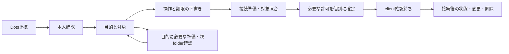

# Dots連携 — レビュー用再設計案

## 解く問いと推薦

解く問いは「利用者がDotsに任せたい目的から、必要な本人確認・対象・権限・接続へ、順番に迷わず進めるか」。既存の責務を新しいタブに移すだけでは解決しない。

構成には二つの実質的な案がある。

| 案 | 利点 | 負担 |
| --- | --- | --- |
| A：一つの目的ガイド＋接続後の管理画面 | 初回は必要な順だけ。接続後は同じ対象の状態・変更・解除に戻れる | draftとserver状態、段階の遷移契約を作り直す必要がある |
| B：接続カード中心のダッシュボード＋不足条件の案内 | 複数接続の管理を最初から並べやすい | 初回にも接続・対象・権限のカードを利用者が組み立てる負担が残る |

**推薦はA。** settings上の主入口を「Dots連携」に一本化し、初回の案内と接続後の状態管理を同じ場所にする。一般MCP用は同ページの「他のMCPクライアントで使う」から同じ目的・対象・許可モデルを使い、Dots固有の転送／App手順だけを差し替える。一般clientの既存stdio機能を削除しない。名前は「Dots連携」「Dotsにつなぐ」「接続を確認」「許可を確認」にし、利用者・担当エージェントの名前を製品ラベルにしない。

新しいfeature／権限方式を今回実装する提案ではない。既存の別権限を同じ案内の中で順に扱う。保存APIを呼んでいないdraftに「許可済み」を付けない。

## 主画面の形

```text
Dots連携
Dotsに任せたいことを選び、対象と許可を確認します。

[Piセッションの操作を手伝ってもらう]
[許可した場所にrepo／workspaceを作ってもらう]（必要な人だけ）

対象       登録workspace名 / 読めるpath / 選択session
許可       この目的に必要な操作 / 期限 / 現在との違い
接続       既存を利用するか、対応経路を準備するか
状態       完了した確認と、今必要な一つの操作

[次へ：対象を選ぶ]                     他のMCPクライアントで使う
詳細（照合ID、generation、接続先の技術情報、診断）
```

上の四つは別々に操作するタブではなく、一つの対象の要約。進行中は次に必要な項目だけを開く。接続後は「対象・できること・期限・接続状況・解除」をまとめた一つの要約に変わる。入力中に自動で別段階へ切り替えない。

本文共有は初回の必須項目にしない。「結果を共有したい」で既存のread／exact final契約に従って別途明示確認する。親folderを許可しなくても既存workspaceのPi補助は設定できる。Pi補助だけが目的の人に親folder欄を通らせない。

## 必要な順のガイド

1. **本人を確認する。** 既存の認証を確認する。未登録／期限切れなら同じ画面で必要な本人確認へ案内し、完了後に戻る。実cookieやキーを保存して復帰させない。本人確認だけで操作を許可しない。
2. **目的と対象を選ぶ。** 登録workspaceを、利用可否の理由も含めて表示する。未観測sessionを理由にworkspaceを消さない。既存session／新規sessionの準備は本人の明示ボタンで行う。repo作成目的のときだけ親folderを選び、未許可ならその許可の確認へ案内する。空workspaceでは勝手に新しいrepoを作らない。
3. **操作と期限を下書きする。** Pi指示登録・明示開始・exact run停止・取消・照合等、目的に対応する操作を具体的に示す。期限は既存安全な既定値から始める。親folder、本文共有、実行開始が含まれないことも要約に書く。この段階は未保存。
4. **接続を用意・照合する。** 安全に帰属が確認できる既存接続を優先する。別binding・不明な接続を止めて新しい接続に置換しない。本人PC入力やclientの再検出が必要なら、この画面に一つの次の操作を示す。31日の転送保持をPi権限と別の表示にする。clientの表示名は認証扱いしない。
5. **必要な許可を順に確定する。** 既存workspace範囲、親folder（選んだ目的の場合）、exact Pi操作、本文共有（希望した場合）を、それぞれのbackend契約と確認receiptで扱う。一つのグリーン表示にまとめて全承認済みと偽らない。各確認は対象・操作・期限・削除される既存許可を表示する。前に確定した項目を不要に再確認させないが、変更・期限・世代が変わったものは再確認する。
6. **client側の対象確認を待つ。** 許可の確定だけでは接続済みにしない。既存のprivate metadata RPCによるexact対象照合等、対応経路の証拠を待つ。「許可済み・client確認待ち」と「使える状態」を区別する。



接続申請がなければexact許可を確定できない、という現在の依存関係を維持する。接続前に利用者が選んだ内容はdraftであり、申請と現在のinstance/revision/session generationが一致してから最終確認する。途中の確定が失敗した場合は、各receiptを照合し、成功した別権限を勝手に巻き戻さない。

## 接続後と解除

主表示例：「プロジェクトAの選択セッションに、指示登録・明示開始・停止・取消・照合を許可。残り12分。転送は接続中。本文共有と新規repo作成は未許可。」長いIDは「詳細」で初めて出す。

「対象・許可を変更」と「連携の状態／解除」を同じ要約に置く。解除panelで、操作許可の解除、本文共有の解除、必要な場合のConsole所有転送の切断を明確に区別する。「この連携を終了」を提供する場合も、どの別操作を実行するかを本人が確認し、結果はそれぞれのreceiptで照合する。部分失敗を「終了済み」にしない。実行中Piの停止は別の明示操作で、解除から暗黙に呼ばない。作成済みrepoや送信済み本文は残る。

現在のworkspace範囲は他の連携にも共有され得る。共有scopeへの変更・同workspaceの他session除外・exact finalの解除を、接続専用変更のように見せない。影響を確認できない場合は「他の連携への影響を確認できません」と表示して確定を止める。per-client権限storeへ変更するかどうかは別のbackend設計判断であり、今回の表示案で既に実現したとは扱わない。

## 自動更新の契約

自動更新を全面手動にする案は単純だが、失効・切断を利用者が見逃しやすい。入力中だけ全取得を止める案では、編集中に必要な失効情報も遅れる。**推薦は、読み取り状態と編集draftを分離し、状態だけを静かに更新する方式。**

| データ | 更新の所有者 | 変えてよいタイミング |
| --- | --- | --- |
| serverSnapshot | 認証された読み取り結果、instance・revision・取得sequence付き | 新しい有効な結果だけ。古い応答、別対象、別画面世代は破棄 |
| draft | 本人が選ぶ対象・操作・期限・purpose | 本人入力、明示した「現在値を取り込む」、確定結果の照合時だけ |
| mutationJournal | nonce／request IDと確認済み結果 | 明示操作開始・同じ結果照合。応答喪失で新しいnonceを自動発行しない |
| viewState | 開いた段階・details・focus・選択位置・scroll | 本人の遷移だけ。単なるrefreshで初期化しない |

背景取得は操作用busy/lockを使わず、入力や戻る・中断ボタンをdisableしない。取得中表示は固定したstatus領域に小さく出す。編集中のfieldへserver値を再代入しない。選択一覧から対象が消えても別対象に切り替えず、選択を「現在は使用不可」として保持する。checkbox、選択位置、IME入力、focus、scroll、開いたdetailsを保持し、DOMをpollのたびにmountし直さない。名前や並び順の更新で操作中の行を移動させない。

期限制限／revoke／generation変更はすぐ要約の警告と確定可否へ反映するが、draftを消したり別段階に飛ばしたりしない。「対象の状態が変わりました。入力は保持しています。再確認する」で本人の遷移を待つ。最終確定では必ずfresh server状態を再照合し、保持したdraftが許可になるとは見なさない。

編集中に競合する新snapshotはpendingとして保持し、「現在の設定が変わりました」の通知から差分を読めるようにする。「自分の入力を保って再確認」「現在値に戻す」を明示する。expiryの毎秒countdownをaria-liveで毎秒読み上げない。通信失敗は最後の取得時刻と「未確認」にし、失効した権限で操作を可能にしない。

戻る・画面を閉じるときは非秘密draftとjournal参照だけを保ち、キー・cookie・JWT・本文を保存しない。再開時は読み取り→未完了receipt照合→変更された前提だけ再確認。認証期限が切れたら再認証後もdraftは残し、許可は自動更新しない。取消はdraftの取消、申請取消、実転送切断を区別する。読み取り更新から準備／許可／延長／切断APIを呼ばない。

## 一般MCPの扱いと未知

一般clientの既存stdio経路を維持し、目的・対象・許可・状態・解除を共通にする。Dots固有のApp/Tunnel手順だけを出さない。対応clientなら確認された正式import／起動手順を短く示し、非対応clientには生成済みの必要最小の設定と手動照合手順を示す。人が3本のランダムキーを作ることをfallbackにしない。clientがsecure handoffを持つかは実証されるまで「自動設定できる」と表示しない。

App再検出・認証・鍵入力の実際の画面、支持されるclientごとの機能、共有scope変更の複数clientへの影響は未確定。今後、一次仕様とsource契約を限定して確認する。MCPのclientInfoを認証や権限の根拠にしない。秘密をURL/argv/log/公開endpoint/チャットに出さない。Web機能の採用時はAGENTSのMDN Baseline方針を再確認し、具体的browserで検証する。今回の文書は新しいWeb APIを採用していない。
